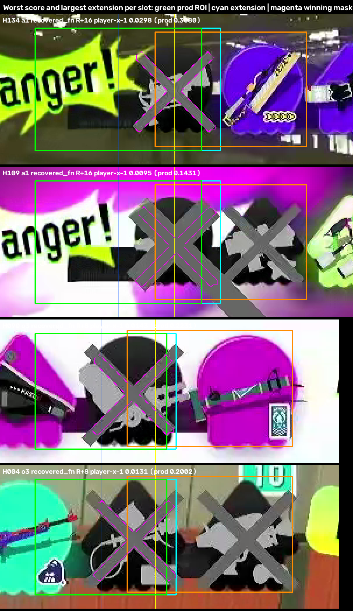

# Held-out validation of the frozen roster reach candidate

Candidate frozen and pre-registered in `FREEZE.md` (commit `0fcf3ed`) before any
held-out frame was decoded: **A1 search area +16 native px right, O3 +8 native
px right**, everything else production (templates, masks, scale, masked
`TM_SQDIFF_NORMED`, threshold 0.03, visibility gate, fusion, coaching).
Production code is unchanged. The values were not altered after scanning or
labeling.

## Result

On fresh held-out live gameplay the candidate fixed 115 slots and broke none.

| Paired slot transition (production -> candidate) | All | Random | Discordant | After 2026-09-10 |
|---|---|---|---|---|
| correct -> correct | 1380 | 724 | 663 | 711 |
| wrong -> correct | **115** | **8** | **108** | **62** |
| correct -> wrong | **0** | **0** | **0** | **0** |
| wrong -> wrong | 0 | 0 | 0 | 0 |

There are no candidate-created false positives, so no FP overlays exist. Every
changed slot is a recovered X, and every recovered placement sits on the slot's
own X (overlays below).

The pre-registered failure rule ("if either value proves inadequate, record the
failure and stop") is **not triggered**: no held-out A1/O3 X is missed by the
candidate and no slot gets worse. Two margin observations are recorded under
*Margins*; neither is a failure under the pre-registered criteria.

## Data

- Pool: 105 unreferenced live 1080p videos (`pool.json`); 104 produced eligible
  frames. 1 Hz scan: 27,697 frames passed the production visibility gate; the
  two methods disagreed on 1,115 frames in 312 runs.
- Sample (seed 20261015): 100 random frames (at most 2 per video) and 100
  discordant runs (one frame each, capped from 312); one frame was in both, so
  199 frames.
- Labels: completed blind to `sealed/key.json`, sealed in `90572c5` before
  scoring. 188 frames `visible`, 11 `hidden` (8 random, 3 discordant). 1,495
  determinable slots, 324 human X, 97 `?` slots (1 on O3, 0 on A1).
- Commit `3e8f1a1` captured an earlier, mostly prefilled draft of
  `labels.csv`; it was never scored. `90572c5` is the label set used here.

## Metrics

All determinable slots, both methods, same frames and labels.

| Set | Method | TP | FP | FN | TN | X precision | X recall | Side count exact | Raw AvB exact |
|---|---|---|---|---|---|---|---|---|---|
| All | production | 209 | 0 | 115 | 1171 | 1.000 | 0.645 | 255/367 | 81/180 |
| All | candidate | 324 | 0 | 0 | 1171 | 1.000 | 1.000 | 367/367 | 180/180 |
| Random | production | 95 | 0 | 8 | 629 | 1.000 | 0.922 | 172/180 | 81/89 |
| Random | candidate | 103 | 0 | 0 | 629 | 1.000 | 1.000 | 180/180 | 89/89 |
| Discordant | production | 116 | 0 | 108 | 547 | 1.000 | 0.518 | 84/189 | 0/92 |
| Discordant | candidate | 224 | 0 | 0 | 547 | 1.000 | 1.000 | 189/189 | 92/92 |
| After 2026-09-10 | production | 110 | 0 | 62 | 601 | 1.000 | 0.640 | 130/191 | 40/95 |
| After 2026-09-10 | candidate | 172 | 0 | 0 | 601 | 1.000 | 1.000 | 191/191 | 95/95 |

The **random** stratum estimates ordinary-frame behavior: production X recall
0.922 (development recomputed production: 0.915) rises to 1.000 with no
precision cost. The **discordant** stratum is by construction the frames where
the methods disagree, so its production numbers are not a frame-level rate.
Raw AvB transitions (all): correct->correct 81, wrong->correct 99,
correct->wrong 0.

The after-2026-09-10 subset (recorded after the template commits, so it cannot
contain the unrecorded template source) shows the same pattern.

### Per slot

| Slot | Set | Paired c->c / w->c / c->w / w->w | Production TP/FP/FN/TN | Candidate TP/FP/FN/TN |
|---|---|---|---|---|
| A1 | all | 126 / 62 / 0 / 0 | 5 / 0 / 62 / 121 | 67 / 0 / 0 / 121 |
| A1 | random | 87 / 5 / 0 / 0 | 5 / 0 / 5 / 82 | 10 / 0 / 0 / 82 |
| O3 | all | 134 / 53 / 0 / 0 | 11 / 0 / 53 / 123 | 64 / 0 / 0 / 123 |
| O3 | random | 89 / 3 / 0 / 0 | 11 / 0 / 3 / 78 | 14 / 0 / 0 / 78 |

All other slots are identical under both methods by construction.

## Held-out A1/O3 X centres and reach

`heldout_results.json` -> `x_reach` lists every held-out human X on A1 and O3
(67 A1, 64 O3) with its centre (best placement over the ROI widened 24 px each
side), reach intervals and both methods' labels.

| Slot | X-centre clusters (native x, count) | Production detected | Candidate detected |
|---|---|---|---|
| A1 | 559 (1), 568 (2), 591-592 (2), **607-609 (62)** | 5 (all centres <= 592) | 67 |
| O3 | 1237-1238 (2), 1247-1248 (2), 1263-1264 (4), 1269 (3), **1279-1281 (53)** | 11 (all centres <= 1269) | 64 |

These are the same clusters found in development (A1 outer cluster 607-608,
O3 outer cluster 1280). Every production miss is in the outer cluster; every
outer-cluster X is recovered by the candidate.

Reachability as computed by the pre-registered field uses the reach interval of
the *free-window best template* (`player-x-3` for O3). Under that template the
candidate's O3 reach ends at 1277.6, so 52 of 53 outer-cluster O3 X are flagged
`reachable_candidate = false` while being detected. The candidate wins those
slots with `player-x-1`, whose placement centre lands at 1279.1-1281.1 (on the
X, within about 0.5 px). So the flag reflects which template the metric uses,
not a miss. A1 has no such discrepancy: all 62 outer-cluster X are reachable
and won by `player-x-1` at 607.1-609.1.

## Margins

These are observations, not failures; the values remain frozen.

1. **O3 +8 is fully used.** 15 of 53 O3 recoveries need all 8 px (placement
   right edge 8 px past the production ROI); none needs more. An O3 X centred
   at 1282 or beyond would not be reached. None was observed in 64 held-out
   O3 X or in development.
2. **A1 +16 uses at most 14 px** (12 px for 43 cases, 13 for 18, 14 for 1).
3. **Recovered A1 scores approach the threshold.** Candidate scores on the 62
   recovered A1: min 0.0095, median 0.0161, max 0.0298 (H134 0.0298, H141
   0.0296). H134 is overlapped by a "Danger!" banner; placement is on the X.
   Recovered O3 scores are well clear (max 0.0143).
4. **Alive headroom.** Lowest candidate score on a human-alive slot: A1 0.0471
   (H095, unchanged from production), O3 0.0474 (H121, production 0.0593).
   Both stay above 0.03.

## Overlays

`sheets/recovered_examples.png`: worst score and largest extension per slot
(H134 A1, H109 A1, H090 O3, H004 O3). Green = production ROI, cyan = candidate
extension, magenta = winning template mask, orange = neighbour ROI.



All 115 recovered overlays are written to `overlays/` by `score` (not committed;
about 32 MB). There are no candidate-FP overlays because there are no candidate
FPs.

## Limitations

- Template provenance is unrecorded; the after-2026-09-10 subset addresses this
  and agrees.
- Random stratum is 92 visible frames; the absence of FPs there bounds the FP
  rate only coarsely. The discordant stratum covers 100 of 312 disagreement
  runs; all 100 sampled were recoveries, none collateral.
- Replay footage, R029 / dark-silhouette handling and Lead!-conditional
  behavior remain out of scope.

## Decision

Production is unchanged. Whether to adopt A1 +16 / O3 +8 in `configs/` and the
detector is the user's decision.

## Reproduce

```bash
cd tools/diagnostics
../../.venv/bin/python roster_heldout_reach.py build --output ../../analysis/importance_report/roster_evidence/heldout_reach
../../.venv/bin/python roster_heldout_reach.py score --output ../../analysis/importance_report/roster_evidence/heldout_reach
```

`score` checks every blind image against its sealed SHA-256 before scoring.
