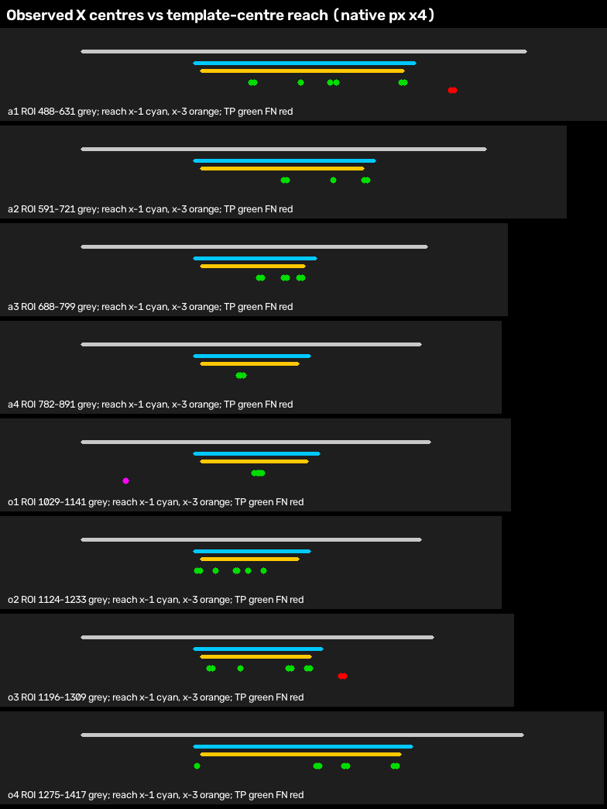

# Roster Experiment 3: X reach and minimal per-slot ROI search extensions

Status: read-only development experiment. `src/`, `configs/`, templates, masks, template scale, the matching algorithm, the threshold `0.03`, fusion and `coach.roster_evidence=false` are unchanged. The sealed labels are development data (76 live samples). **No candidate is selected here**; the tradeoff is reported for your decision.

Tool: `tools/diagnostics/roster_roi_reach.py`. Results: `roi_reach.json`, `lead_badge_audit.json`, `sheets/`, `overlays/`.

## Method

- **Population.** Every human-determinable live slot from samples with a stored detector reading: 607 slots, 106 human-X. This matches the population of `BASELINE.md`. Every frame was re-decoded with the label sampler's seek and verified against the sealed image hash.
- **Candidate definition.** Widen one slot's production ROI by `R` native pixels to the right only. Then run the production matcher on that wider crop:
  - templates are fitted against the production ROI, so scale and masks are identical;
  - masked `TM_SQDIFF_NORMED` is unchanged, including skipping templates that produce NaN, as production does;
  - the threshold stays at `0.03`.
- **Equivalence check.** At `R = 0` the score equals production `_best_masked_sqdiff` on all 607 slots (0 mismatches).
- **Production reference.** "Production" below means recomputed on the verified frames. It differs from the stored key in one slot only: R019 O4 is stored `x` (0.0293) but recomputes as alive (0.0318). That is why the reference is 3 false positives, side count 139/151 and AvB 63/75, rather than the stored 4 false positives, 138/151 and 62/75.
- **Sweep.** Extensions `R ∈ {4, 8, 12, 16, 20, 24}` were run independently per slot, then uniformly on all slots, then as an A1 × O3 grid. A 1 px sweep from 0 to 24 was also run per slot, to find each false negative's exact minimum extension and the alive-score margin.
- **Left side.** Left extension was **not** tested, because the data does not show a need for it (next section).
- **R029 O1 (dark silhouette, no X marker)** is kept separate. It stays a false negative under every candidate, and no right extension changes it.

## 1. Empirical X-centre distribution vs reach

The X centre is the mask-centroid centre of the best placement within ±24 px. The reach interval is the range of template centres that the winning template can reach with a full placement inside the production ROI. `sheets/x_center_reach.png` plots every X against its slot's reach bars.



| Slot | ROI x | Reach (x-1) | X-centre clusters (n) |
|---|---|---|---|
| A1 | 488–631 | 524.1–595.1 | 543 (2), 559 (1), 568–570 (2), 591–592 (4), **607–608 (5 FN)** |
| A2 | 591–721 | 627.1–685.1 | 656–657 (6), 672 (2), 682–683 (3) |
| A3 | 688–799 | 724.1–763.1 | 745–746 (4), 753–759 (8) |
| A4 | 782–891 | 818.1–855.1 | 833–834 (14) |
| O1 | 1029–1141 | 1065.1–1105.1 | 1085–1087 (13); R029 no marker |
| O2 | 1124–1233 | 1160.1–1197.1 | 1161–1162 (3), 1167 (2), 1174–1178 (6), 1183 (3) |
| O3 | 1196–1309 | 1234.6–1269.6 (x-3) | 1237–1238 (4), 1247 (2), 1263–1264 (2), 1269–1270 (2), **1280–1281 (3 FN)** |
| O4 | 1275–1417 | 1311.1–1381.1 / 1313.6–1377.6 (x-3) | 1312 (3), 1351–1352 (5), 1360–1361 (3), 1376–1377 (3) |

### Every X within 15 px of a boundary, or beyond one

All other X's (excluding R029 O1) are 15 px or more inside both boundaries.

| Boundary | Distance | True positives | False negatives |
|---|---|---|---|
| right | beyond 10–14 | — | A1: R013, R023, R028, R036, R101; O3: R021, R022, R119 |
| right | inside 0 | O3 R082 (1269.6 vs 1269.6) | — |
| right | inside 1–4 | A1 R006, R063, R071, R093; A2 R009, R011, R119; A3 R013, R101; O3 R076; O4 R004, R022, R036 | — |
| right | inside 5–9 | 7 X's (A2, A3, O2, O3, O4) | — |
| right | inside 10–14 | 6 X's | — |
| left | inside 1–4 | O2 R016, R018, R066; O4 R002, R066, R108 | — |
| left | inside 5–9 | 6 X's | — |
| left | inside 10–14 | 6 X's | — |
| left | beyond | none | none |

Full per-X bins are in `roi_reach.json → x_distribution`.

**No X lies beyond any left boundary**, so the data does not show a need for left-side search. Left-side margins of 1–4 px exist in O2 and O4, but those X's are already detected. Symmetric expansion was therefore not tested.

## 2. Minimum extension per false negative (1 px sweep)

| FN | Min right extension | Score at minimum | Placement |
|---|---|---|---|
| R021 O3 | 5 px | 0.0131 | target X |
| R022 O3 | 5 px | 0.0115 | target X |
| R119 O3 | 6 px | 0.0112 | target X |
| R023 A1 | 12 px | 0.0176 | target X |
| R028 A1 | 12 px | 0.0132 | target X |
| R036 A1 | 12 px | 0.0159 | target X |
| R013 A1 | 13 px | 0.0127 | target X |
| R101 A1 | 13 px | 0.0149 | target X |
| R029 O1 (separate) | not recovered at ≤ 24 | 0.130 | other content |

O3 needs **6 px** and A1 needs **13 px**. At exactly those values, the outermost observed X sits at the reach edge with no slack. Every recovery lands on the target slot's own X; none is a neighbour's X.

## 3. Tradeoff curve: all 607 determinable live slots

Production reference values:

| Metric | Value |
|---|---|
| X precision / recall | 0.9700 / 0.9151 (TP 97, FP 3, FN 9) |
| Slot accuracy | 0.9802 |
| A1 accuracy | 0.9211 |
| O3 accuracy | 0.9605 |
| Side count | 139/151 |
| Raw AvB | 63/75 |

The existing false positives are R049 O4, R052 A1 and R057 O4. They are retained under every candidate, because widening the search can only lower a slot's best score.

### Per-slot, right-only, independent

| Candidate | Recovered FN | New FP | X precision | X recall | Slot acc | Slot's own acc | Side count | Raw AvB | AvB transitions |
|---|---|---|---|---|---|---|---|---|---|
| A1 +4 | 0 | 0 | 0.9700 | 0.9151 | 0.9802 | 0.9211 | 139/151 | 63/75 | unchanged |
| A1 +8 | 0 | 0 | 0.9700 | 0.9151 | 0.9802 | 0.9211 | 139/151 | 63/75 | unchanged |
| A1 +12 | 3 | 0 | 0.9709 | 0.9434 | 0.9852 | 0.9605 | 142/151 | 66/75 | 3 wrong→correct, 0 correct→wrong |
| A1 +16 | 5 | 0 | 0.9714 | 0.9623 | 0.9885 | 0.9868 | 144/151 | 68/75 | 5 wrong→correct, 0 correct→wrong |
| A1 +20 | 5 | 0 | 0.9714 | 0.9623 | 0.9885 | 0.9868 | 144/151 | 68/75 | same as +16 |
| A1 +24 | 5 | 0 | 0.9714 | 0.9623 | 0.9885 | 0.9868 | 144/151 | 68/75 | same as +16 |
| O3 +4 | 0 | 0 | 0.9700 | 0.9151 | 0.9802 | 0.9605 | 139/151 | 63/75 | unchanged |
| O3 +8 | 3 | 0 | 0.9709 | 0.9434 | 0.9852 | 1.0000 | 142/151 | 66/75 | 3 wrong→correct, 0 correct→wrong |
| O3 +12 … +24 | 3 | 0 | 0.9709 | 0.9434 | 0.9852 | 1.0000 | 142/151 | 66/75 | same as +8 |

For A2, A3, A4, O1, O2 and O4, no extension from +4 to +24 changes any label: 0 recoveries and 0 new false positives.

### Uniform right extension on all eight slots

| Candidate | Recovered FN | New FP | Precision / recall | Slot acc | Side count | Raw AvB |
|---|---|---|---|---|---|---|
| all +4 | 0 | 0 | 0.9700 / 0.9151 | 0.9802 | 139/151 | 63/75 |
| all +8 | 3 | 0 | 0.9709 / 0.9434 | 0.9852 | 142/151 | 66/75 |
| all +12 | 6 | 0 | 0.9717 / 0.9717 | 0.9901 | 145/151 | 69/75 |
| all +16 / +20 / +24 | 8 | 0 | 0.9722 / 0.9906 | 0.9934 | 147/151 | 71/75 |

### A1 × O3 grid (recovered FN / new FP / raw AvB)

| A1 \ O3 | +4 | +8 | +12…+24 |
|---|---|---|---|
| +4, +8 | 0 / 0 / 63 | 3 / 0 / 66 | 3 / 0 / 66 |
| +12 | 3 / 0 / 66 | 6 / 0 / 69 | 6 / 0 / 69 |
| +16…+24 | 5 / 0 / 68 | **8 / 0 / 71** | 8 / 0 / 71 |

The remaining 4 raw AvB errors at the best point come from the 3 retained false positives and R029 O1.

### Collateral margin: how close the extension pushes alive slots toward 0.03

No candidate creates a new false positive, so there are no new-false-positive attributions or overlays. This is the whole false-positive result: 0 of 607 slots flip to `x`, so no extension in this sample made a neighbouring player's X reachable. Adjacent same-frame X centres in this sample are 75–98 px apart, far beyond a 24 px extension.

Because "zero" alone hides how close it came, the table below lists the lowest alive score in each extended slot. It excludes the existing false positives, which are unchanged. The overlays for the most-moved alive slot per slot at +24 are in `sheets/alive_headroom.png`. Every one is classified `other_content`, not a neighbour X.

| Extended slot | Lowest alive score: production → +12 → +16 → +24 | Most-moved alive slot |
|---|---|---|
| A1 | 0.0606 → 0.0606 → 0.0606 → 0.0606 | R108 A1: 0.111 → 0.0705 at +16 |
| O3 | 0.1006 → 0.0628 → 0.0542 → 0.0468 | R049 O3 (its O4 is an existing FP): 0.115 → 0.0468 at +24 |
| A3 | 0.0924 → 0.0924 → 0.0894 → 0.0620 | — |
| O2 | 0.0746 → 0.0679 → 0.0679 → 0.0679 | — |
| O4 | 0.0193 → 0.0153 (existing FP R057) | R019 O4: 0.0318 → **0.030026** at +4. This is the stored-`x` slot, now 0.00003 above threshold. |

Two cautions follow from this table:

- **O3's alive margin shrinks steadily with extension.** From 0.101 it falls to 0.054 at +16 and 0.047 at +24. Under +8, which is enough for all O3 recoveries, the minimum is 0.077.
- **Do not extend O4.** It recovers nothing, and +4 alone puts R019 O4 within 0.00003 of the threshold.

Recovered false negatives are shown in `sheets/recovered_fn.png`, with one PNG per case in `overlays/`. Each overlay shows the production ROI (green), the extension (cyan), the winning mask (magenta), the target centre (blue), the target/neighbour divider (yellow) and the neighbour ROI (orange).

## 4. Do the clusters follow an observable layout state?

**The rows are anchored at the timer.** A4 (833–834) and O1 (1085–1087) each form a single tight cluster. The outer slots spread outward in discrete steps, so the outer positions depend on the widths of the inner icons.

**The labelled roster pattern does not predict the cluster.** The tested features were own-side X pattern, other-side pattern, alive counts, battle mode (almost all Splat Zones), stage and match. For A1 the best of these, the match identity, has a purity of only 0.79; for O3 it is 0.85. Several values of every feature span more than one cluster (`roi_reach.json → layout.*.predictors`).

**The side of the "Lead!" / "リード!" badge tracks the coarse layout.** This comes from a manual audit (`lead_badge_audit.json`, `sheets/layout_rows_a1.png`, `sheets/layout_rows_o3.png`); an automated colour detector was tried, was unreliable, and is not used.

- **O3:** with allies leading, X centres were 1237–1247 (6/6). With opponents leading, they were 1263–1281 (7/7), including all 3 false negatives.
- **A1:** with allies leading, X centres were 543–568 (4/4). With opponents leading, they were 570–608 (10/10), including all 5 false negatives.
- The leading team's row appears wider, as if its icons are enlarged. The trailing row is compacted toward the timer. That moves A1 inward, toward its right edge, when opponents lead, and O3 outward, also toward its right edge, when opponents lead.

The badge does **not** decide the fine cluster within a side. With opponents leading, A1 still varies across 570, 591 and 607, and O3 across 1263, 1269 and 1280. So a badge-conditional ROI would choose between coarse ranges, not exact positions. It also depends on the badge being present, which requires a leading team in a ranked mode; this sample is almost entirely Splat Zones.

**A possible future conditional-ROI approach (not implemented):** condition the A1 and O3 right reach on the badge side. The data does not show that this beats a static right extension: the static candidates already have zero new false positives here. Its only potential benefit is limiting O3's shrinking alive margin to frames where opponents lead.

## Summary for decision

- A right-only extension of **A1 by ≥ 13 px and O3 by ≥ 6 px** recovers all 8 reach false negatives.
  - In this sample, every candidate up to +24 produces **0 new false positives** and **0 correct→wrong transitions**.
  - The smallest candidate in the grid that achieves all 8 is **A1 +16, O3 +8**: precision 0.9722, recall 0.9906, side count 147/151, raw AvB 71/75. That is +8 and +8 over production.
  - A1 +12 recovers only 3 of the 5 A1 false negatives, and A1 +13 has zero slack at the outermost cluster.
- The collateral margin is real but not consumed. O3 alive scores fall toward 0.047 by +24; A1 alive scores do not move toward the threshold.
- Do not extend any slot other than A1 and O3. They gain nothing, and O4 +4 brings R019 O4 within 0.00003 of the threshold.
- This is development data with 8 positives in the target clusters. It cannot establish held-out false-positive rates, fusion effects or replay behaviour.
- R029 O1 remains open as a separate labelling and semantics question.

Regenerate:

```bash
.venv/bin/python tools/diagnostics/roster_roi_reach.py \
  --baseline analysis/importance_report/roster_evidence/baseline/labels \
  --output analysis/importance_report/roster_evidence/roi_reach
```
