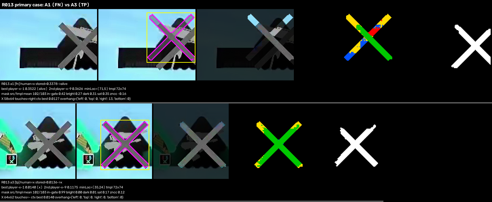

# Roster X appearance study: live false-negative vs correctly detected X

Status: read-only development diagnostic. The production detector, templates, masks, threshold `0.03`, fusion and `coach.roster_evidence=false` are unchanged. The sealed labels are development data, not held-out validation.

Tool: `tools/diagnostics/roster_x_appearance.py`. Artifacts: `x_appearance.json`, `x_appearance.csv`, `sheets/`.

## Summary

The live false negatives are not an X-appearance problem. They form two families:

1. **The X is beyond the ROI's reachable placement (8 of 9; slots A1 ×5, O3 ×3).** The X marker sits 10–13 px further right than the fixed ROI lets a template be placed. Masked `TM_SQDIFF_NORMED` only scores full-template placements, so the true X position cannot be scored and the template lands on icon artwork instead. When the same production templates are run on the same native pixels with a 24 px margin around the ROI, all 8 score 0.0074–0.0176. The 97 correctly detected X score 0.0074–0.0253, so these 8 are inside that range.
2. **There is no X marker (1 of 9; R029 O1).** The icon is a dark silhouette with no X drawn. It was labeled `x` under the dark-silhouette labeling rule. The detector is not mis-seeing a visible X; it is a semantic state with no marker.

When the X is placeable, its appearance is the same in false negatives and true positives: gray level, arm angle, arm thickness, contrast, team hue and underlying weapon art. No template, threshold or classifier change is supported by this evidence.

This **corrects the Experiment 1 audit** (`dynamic_roi/GEOMETRY.md`), which classified all 13 known misses as "classification with adequate icon coverage" with no clipping. That audit judged the icon. For 8 of the 9 false negatives, the **X marker** extends past the ROI's right edge. Experiment 2 could not fix this: Variant A searched only inside the fixed crop, and Variant B is narrower than the fixed crop.

## Scope and counts

- The sealed key contains **9** live false-negative X slots, not 10. The 13 known live misses are these 9 false negatives plus 4 false positives (R019 O4, R049 O4, R052 A1, R057 O4). The false positives are out of scope here.
- Controls: all **97** live true-positive X slots (human `x`, stored `x`).
- Every frame was re-decoded with the label sampler's cv2 seek. Each was re-rendered into the blind label image and matched the sealed `image_sha256` (106/106 slots verified).
- Stored and recomputed labels agree on all 106 slots. Scores below are recomputed on the verified frame; stored scores are kept in the JSON and CSV.

## Per-example evidence (false negatives)

The ROI is the native-resolution production ROI. "Best" is the production in-ROI result. "Context" is the diagnostic probe with a 24 px margin, using the same templates and masks and no rescaling. "Reach" is the range of X-center positions a full template placement can reach inside the ROI.

| Sample | Slot | Stored | Best template / score | 2nd template / score | minLoc | X center x | Reach | Context template / score | Overhang | Family |
|---|---|---|---|---|---|---|---|---|---|---|
| R013 | A1 | 0.3378 | x-1 / 0.3522 | x-9 / 0.3626 | (71,5) | 608.1 | 524.1–595.1 | x-1 / 0.0127 | right 13 | reach |
| R023 | A1 | 0.3365 | x-1 / 0.3514 | x-9 / 0.4601 | (71,6) | 607.1 | 524.1–595.1 | x-1 / 0.0176 | right 12 | reach |
| R028 | A1 | 0.1491 | x-1 / 0.1424 | x-7 / 0.1498 | (0,0) | 607.1 | 524.1–595.1 | x-1 / 0.0132 | right 12 | reach |
| R036 | A1 | 0.2206 | x-1 / 0.2174 | x-9 / 0.2278 | (6,0) | 607.1 | 524.1–595.1 | x-1 / 0.0159 | right 12 | reach |
| R101 | A1 | 0.2575 | x-1 / 0.2635 | x-9 / 0.2923 | (66,0) | 608.1 | 524.1–595.1 | x-1 / 0.0149 | right 13 | reach |
| R021 | O3 | 0.2136 | x-1 / 0.2168 | x-9 / 0.2370 | (41,21) | 1279.6 | 1234.6–1269.6 | x-3 / 0.0089 | right 10 | reach |
| R022 | O3 | 0.1522 | x-1 / 0.1537 | x-8 / 0.1936 | (41,12) | 1279.6 | 1234.6–1269.6 | x-3 / 0.0074 | right 10 | reach |
| R119 | O3 | 0.1038 | x-1 / 0.1101 | x-9 / 0.1330 | (6,0) | 1280.6 | 1234.6–1269.6 | x-3 / 0.0076 | right 11 | reach |
| R029 | O1 | 0.2597 | x-9 / 0.2636 | x-10 / 0.2685 | (0,0) | (no X) | 1065.1–1105.1 | x-1 / 0.0910 | — | no marker |

For all 97 true positives, the context probe returns the same placement and score as the production ROI (maximum difference 2e-7, zero overhang). The margin only changes results where the X cannot be reached.

## X positions are discrete layout positions

X centers take a small set of discrete horizontal positions per slot, consistent with HUD layout variants. Every false negative in the reach family is at a slot's **rightmost** observed position:

| Slot | ROI x | Observed X centers (px) | Reach upper bound | False-negative centers |
|---|---|---|---|---|
| A1 | 488–631 | 543, 544, 559, 568, 570, 591, 592, **607, 608** | 591.6–595.1 | 607–608 (all 5) |
| O3 | 1196–1309 | 1237, 1238, 1247, 1263, 1264, 1269, 1270, **1280, 1281** | 1269.6–1273.1 | 1280–1281 (all 3) |

The reach upper bound depends on the winning template's width and mask centroid. The reach family covers 7 different matches, so it is not a single-session artifact.

Several correctly detected slots already sit within a few pixels of the reach limit:

| Slot | Smallest TP margin to left / right reach limit (px) |
|---|---|
| A1 | 16 / 3 |
| A2 | 29 / 2 |
| A3 | 21 / 4 |
| A4 | 12 / 19 |
| O1 | 17 / 15 |
| O2 | 1 / 11 |
| O3 | 5 / 0 |
| O4 | 1 / 1 |

A layout position a few pixels further out in any of these slots would produce the same failure.

## Within-frame comparisons

Each pair is on the same side of the same frame unless marked cross-side. Measurements come from the production in-ROI placement. Mask in-gate is the share of source pixels under the winning mask within gray [70,140]. Intrusion is the share that is bright, dark or saturated.

| Frame | FN slot / TP slot | FN best / 2nd | TP best / 2nd | FN mask in-gate (bright/dark/sat) | TP mask in-gate | FN / TP X gray | FN / TP arm angles | FN / TP X center vs reach |
|---|---|---|---|---|---|---|---|---|
| **R013** | A1 / A3 | 0.352 / 0.363 | 0.014 / 0.118 | 0.42 (0.27/0.31/0.35) | 0.99 | 103.1 / 103.2 | 45.9,-45.2 / 45.0,-44.9 | 608 vs ≤595 / 759 vs ≤763 |
| R021 | O3 / O1 | 0.217 / 0.237 | 0.010 / 0.012 | 0.63 (0.14/0.23/0.11) | 1.00 | 103.2 / 104.1 | 45.5,-45.6 / 50.9,-46.2 | 1280 vs ≤1270 / 1085 vs ≤1102 |
| R021 | O3 / O2 | same | 0.008 / 0.011 | same | 1.00 | 103.2 / 102.9 | — / 44.7,-45.1 | — / 1183 vs ≤1194 |
| R022 | O3 / O4 | 0.154 / 0.194 | 0.007 / 0.010 | 0.63 (0.22/0.15/0.12) | 1.00 | 103.2 / 102.6 | 46.6,-47.4 / 45.2,-45.2 | 1280 vs ≤1270 / 1376 vs ≤1378 |
| R029 | O1 / O2 | 0.264 / 0.269 | 0.014 / 0.014 | 0.32 (0.27/0.41/0.42) | 1.00 | no X / 100.0 | no X / 49.1,-39.5 | no marker |
| R101 | A1 / A3 | 0.264 / 0.292 | 0.018 / 0.088 | 0.51 (0.16/0.33/0.10) | 0.99 | 105.3 / 101.9 | 44.0,-46.3 / 45.0,-45.1 | 608 vs ≤595 / 759 vs ≤763 |
| R036 (cross-side) | A1 / O4 | 0.217 / 0.228 | 0.009 / 0.010 | 0.34 (0.35/0.31/0.87) | 1.00 | 103.0 / 103.3 | 45.8,-45.3 / 45.2,-46.0 | 607 vs ≤595 / 1377 vs ≤1378 |
| R119 (cross-side) | O3 / A2 | 0.110 / 0.133 | 0.016 / 0.026 | 0.74 (0.21/0.05/0.75) | 1.00 | 102.9 / 103.1 | 45.5,-45.5 / 45.6,-45.4 | 1281 vs ≤1270 / 683 vs ≤685 |

R023 and R028 have no correctly detected X in the same frame. Their matched controls are R006 A1 and R063 A1, both at a reachable A1 position.

### R013 primary case (`sheets/R013_primary.png`)

A1 and A3 are equally obvious to a human, and the X paint is identical in the two. Mean gray is 103.1 vs 103.2, the arms lie at about ±45°, and the arm thickness is about 6.8 px in both. Underlying icon art does not explain the difference either: both X's lie over a dark icon body with white weapon artwork.

The difference is position. A3's X center (759) sits inside A3's reachable range (≤763), so `player-x-1` lands on it with 99% of mask pixels in the gray gate and scores 0.014. A1's X center (608) is 13 px beyond A1's reachable limit (≤595). The best full placement inside the ROI is offset from the real X, so the mask covers icon body, sky and the X only partly: 42% in-gate, 27% bright, 31% dark, 35% saturated. The score is 0.352. With room to place the template, the same `player-x-1` scores 0.0127 on A1's X.



## Correlation with the requested factors

| Factor | Finding |
|---|---|
| Template | In-ROI winners for the false negatives are mostly `player-x-1`, but that is whichever template least-badly fits a misplaced window. With a margin the reach family is won by `x-1` (A1) and `x-3` (O3), the same templates that win true positives (`x-1` 64, `x-3` 31). No template-specific failure. |
| Slot | A1 5/14 X slots, O3 3/13, O1 1/14 (no marker), every other slot 0. The pattern follows slots whose rightmost layout position exceeds the ROI's reach. |
| X scale | Unclipped false-negative X's match the existing templates at native scale (0.0074–0.0176). Measured X extents in false negatives are smaller only because the X is cut by the ROI edge. |
| X position | Decisive. All 8 reach cases are 10–13 px beyond the reach limit; all 97 true positives are within it. |
| Contrast / brightness | X gray: false negatives 102.9–105.3 vs true positives 89.4–112.2. Ring contrast: 9.7–39.7 vs 0.1–52.4. ROI brightness and std overlap. No separation. |
| Orientation | False-negative arm angles are 44.0–46.6° and -47.4 to -45.2°, inside the true-positive spread. No separation. |
| Team hue | False negatives span 36–324°. Pairs share or differ in hue without effect. No separation. |
| Underlying icon / weapon art | The in-ROI intrusion of bright, dark and saturated pixels under the mask is large for false negatives and near zero for true positives. It is a consequence of the forced misplacement, not a cause: the same icons score as true positives once the template can reach the X. |

Automatic X segmentation (the neutral-gray component) was audited visually in the sheets and is not used alone to attribute a cause. The decisive evidence is the context probe plus the visual ROI-edge overlays.

## What this does and does not establish

- It establishes that 8/9 live false negatives in this development sample are template-compatible X markers whose positions the fixed ROI cannot reach.
- It does **not** validate any fix. The 24 px context probe was fixed before inspection and is diagnostic only. It was not run on alive slots, where a margin could let a neighbor's X into the search. False-positive risk, fusion effects and replay behavior are unmeasured.
- It gives a reason to revisit localization, which was the stated condition for reopening it after Experiment 2. The question is now narrow and checkable: per-slot horizontal reach against the discrete layout positions, especially each slot's outermost position.
- R029 O1 (dark silhouette, no X) is a separate semantic question, either a label policy or a different cue. No X template can detect it.
- This analysis does not support classifier work: threshold tuning, new templates, mask changes or training.

## Artifacts

- `x_appearance.json`: per-slot rows (106), within-frame pairs, matched controls, false-negative vs true-positive distributions and per-slot positions.
- `x_appearance.csv`: flat per-slot table.
- `sheets/fn_live.png`, `sheets/tp_matched.png`, `sheets/fn_vs_tp_interleaved.png`: directly comparable rows. Each row shows the original ROI, the template at minLoc (magenta mask outline, yellow template box), the mask support over source pixels, the gate classes under the mask (green in-gate, red bright, blue dark, yellow saturated) and the neutral-gray X segmentation.
- `sheets/within_frame_pairs.png`, `sheets/R013_primary.png`: false-negative and true-positive rows from the same frame.
- `sheets/context_probe.png`: native pixels around each false negative and its control, with the ROI (green) and the margin-allowed best template (magenta).
- `sheets/tp_weakest12.png`: the true positives closest to the threshold.
- `sheets/templates.png`: the 11 production templates and their derived masks.

Regenerate:

```bash
.venv/bin/python tools/diagnostics/roster_x_appearance.py \
  --baseline analysis/importance_report/roster_evidence/baseline/labels \
  --output analysis/importance_report/roster_evidence/x_appearance
```
