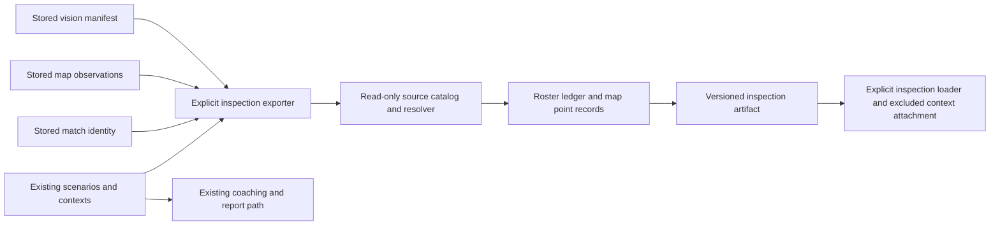

# Roster/map provenance and observation gaps — design for review

**Status: proposed design only. Production implementation is not authorized.**

This proposal follows the [evidence inventory](SCENARIO_CONTEXT_EVIDENCE_INVENTORY.md). It covers preserved roster and map observations, source resolution, explicit gaps, serialization and compatibility. The only executable work accompanying this document is a synthetic probe calling the existing implementation. No detector, fusion rule, context builder, coaching claim, ranking, prompt, configuration or report has been changed by this design work.

## 1. Recommended design decisions

1. **Retain a per-frame roster evidence ledger.** Do not replace or change the compressed `players.trajectory`, anchor/death samples or pre-death selector. Each recorded cadence frame can retain accepted fused counts, raw reading availability and source references, including nulls. This distinguishes an unchanged state after an unreadable gap from uninterrupted readable samples.
2. **Preserve map observations as point samples with source metadata.** Keep the original fractions, pixel denominators, stage/mode, mask identity and observation references. Preserve missing fields as missing; do not manufacture confidence or denominator values from model defaults.
3. **Use a separate inspection artifact first.** Proposed filename: `scenario_observation_evidence.json`. It is keyed to existing scenario/context identities and source hashes. An optional inspection-only `ScenarioContext.observation_evidence` attachment is excluded from default serialization, following the existing `objective` boundary. Normal analysis/context/CoachInput serializers and consumers remain unchanged in the first implementation slice.
4. **Make gaps explicit without claiming uninterrupted state elsewhere.** A roster gap records sampled frames with unavailable paired counts and its observed boundaries. A missing source frame or unresolved schedule has a different status from an explicitly hidden roster reading. Map intervals between retained samples are unsampled intervals, not detection failures or proof that the map was closed.
5. **No consumer migration in this slice.** New metadata does not alter existing values, sample selection, confidence policy, plausibility checks, citations, claims, ranking, prompts or public responses. Any later use of the new ledger to reject a stale pre-death sample needs separate authorization and output-impact review.

A strictly additive inspection artifact is a narrower first step than changing the active trajectory representation. It makes the evidence inspectable while preserving the current report behavior.

## 2. Focused experiment, run before choosing the roster representation

### Method

[The probe](experiments/roster_gap_probe.py) constructs synthetic 2 FPS `VisionFrameResult` records. Visible frames contain one X marker on each side, representing 3 allies and 3 opponents alive. Hidden frames contain `roster_visible=False` and confidence 0. Timer readings supply ordinary match context. The script calls the existing `fuse_game_state`, `build_players_evidence`, and `pre_death_roster` functions without modifying them or re-running a vision detector.

The experiment uses the existing roster confirmation/hold settings (2 agreeing readings, 1-second hold) and context lookup gap (1 second). It does not assert detector accuracy or that a particular real recording has this problem. The death anchor is supplied to isolate roster projection; the script does not simulate a full death UI or score a match.

Run from the repository root:

```sh
.venv/bin/python docs/evidence/experiments/roster_gap_probe.py
```

The [saved deterministic results](experiments/roster_gap_probe.results.json) contain source sample times, current context output and selected pre-death samples. They are synthetic design evidence, not a gameplay analysis artifact or a proposed new schema implementation.

### Results

| Case | Readable observations | Unreadable observations | Current compressed trajectory | Current `at_death` source time | Current pre-death source time |
|---|---|---|---|---|---|
| Long-gap probe, expanded window | 0.0, 0.5, 21.0, 21.5 | 40 frames at 1.0…20.5 | `[0.0 → 3v3]` | 21.5 | 0.0, 22 video seconds before anchor |
| Gap within normal 8-second lookback | 10.0, 10.5, 17.0, 17.5 | 12 frames at 11.0…16.5 | `[10.0 → 3v3]` | 17.5 | 10.0, 8 video seconds before anchor |
| Readable control, same window | All 16 frames at 10.0…17.5 | None | `[10.0 → 3v3]` | 17.5 | 10.0, 8 video seconds before anchor |

**Observed result:** the last two cases have exactly equal current `PlayersEvidence` JSON, including trajectory, anchor/death samples and plausibility flags. Their underlying snapshots differ: fusion exports null paired counts for all 12 hidden frames in the gap case. `observations_from_snapshots` drops those nulls, then equal-count compression retains the first point. The fresh resumed observation survives the independent nearest lookup, but is absent from the compressed trajectory. The pre-death selector reads that trajectory without a separate freshness maximum.

The long-gap case deliberately uses a wider context window to keep both observed endpoints. The six-second gap case fits the ordinary 8-second lookback, so the result is not limited to an unusually large window.

This proves **loss of observational distinction**, not that current code explicitly declares continuous state or that a death/respawn happened during the gap. Either match could have unobserved roster changes and return to 3v3. The new representation must preserve what was observed and unavailable, without choosing among those histories.

### Representation choice

| Candidate | Distinguishes the probe? | Tradeoff | Decision |
|---|---|---|---|
| Existing first-point trajectory | No | Small, but removes gaps and repeated confirmations | Preserve solely as the unchanged legacy coaching path |
| First/last point of an equal-value run | Not on its own | A run from 10.0 to 17.5 can still hide the unreadable middle | Do not use as authoritative evidence |
| Explicit sampled spans plus gap records | Yes, if split correctly | Requires extra grouping/coverage policy and can sound like continuous state | Possible later derived view; not the first source of truth |
| Per-recorded-frame ledger plus explicit gap summaries | Yes | More records, but directly auditable and preserves null/partial samples | **Recommended inspection representation** |

A ledger costs roughly the cadence frame count within the existing context window. A 40-second window at 2 FPS has about 81 samples. Do not silently truncate a larger custom window; report a resource limit explicitly or require an explicit export bound. Compact derived summaries can be added later without discarding the ledger.

## 3. Proposed schemas

These are schema specifications for review, **not implemented Python classes**. Implement persisted models with Pydantic, explicit versioning and validation if this design is approved. All times below are video seconds; no field means remaining game time unless named otherwise. The new artifact stores structured codes, values and references, not player-facing English sentences.

### 3.1 Artifact and source records

| Model | Proposed fields | Rules |
|---|---|---|
| `ObservationInspectionArtifact` | `schema_version: Literal[1]`; `rule_id: Literal['roster_map_observation_provenance_v1']`; `analysis_id: str | None`; `video_identity: str | None`; `parameters: InspectionParameters`; `sources: list[ArtifactSource]`; `contexts: list[ContextObservationEvidence]` | Analysis/video IDs are copied, never generated to repair missing input. Missing identity makes source verification partial. One entry per existing scenario ID, in source context order. No policy/experiment identity. |
| `InspectionParameters` | `context_lookback_seconds`; `context_lookforward_seconds`; `coverage_break_gap_seconds`; `parameter_basis: explicit_inspection_parameters` | Record the exact export parameters. They describe this inspection, not the historical scenario-builder configuration; that configuration cannot be recovered from a vision-config hash alone. Reuse existing parameter types/defaults without changing them. |
| `ArtifactSource` | `key` in `vision_manifest`, `map_observations`, `match_identity`, `scenario_contexts`, `scenarios`; `filename: str`; `sha256: str | None`; `availability` in `present`, `missing`, `invalid`; `limitations: list[str]` | Filenames are fixed relative artifact names, not arbitrary paths/URLs. Hash exact stored bytes, not reserialized models. An empty list is distinct from missing or invalid data. An exporter receives the analysis root as input. |
| `SourceRecordRef` | `artifact_key`; `artifact_sha256: str | None`; `json_pointer: str | None`; `result_id: str | None`; `resolution` in `resolved`, `missing`, `ambiguous`, `mismatched`, `unavailable` | Preserve supplied IDs even if unresolved. A resolved record must exist in the exact hashed source and satisfy type/time/value checks. JSON pointers use original array positions before filtering/sorting. No fabricated detector IDs or nearest-time joins. |
| `ObservedFrameRef` | The existing `SourceFrameReference` fields, all copied where stored | Reuse source timestamp, frame ID, source frame index, PTS/time base and frame path. Missing decoder provenance remains null. Do not infer PTS/index from FPS. A frame timestamp is not a gameplay event-onset timestamp. |

The exporter indexes detector IDs to actual `DetectorResult` records, and frame IDs to actual frame records. Duplicate IDs/timestamps or conflicting frame/snapshot joins are explicit resolution problems, not “pick the first.” Snapshot and current-raw-reading references remain separate.

Calibration's historical `accepted_frame_ids` may contain **roster detector-result IDs**, because the calibrator is passed the positive roster evidence ID. Resolve identifiers against actual result/frame catalogs rather than trusting the field name. Preserve labels such as a fallback `frame@…` verbatim if they do not resolve; do not invent matching source frames.

### 3.2 Context envelope and isolation

| Model | Proposed fields | Rules |
|---|---|---|
| `ContextObservationEvidence` | `scenario_id`; `scenario_ref: SourceRecordRef`; `legacy_context_ref: SourceRecordRef`; `window: InspectionWindow`; `roster: RosterObservationEvidence | None`; `map_ink: MapInkObservationEvidence | None`; `limitations: list[str]` | Existing scenario/context identity is authoritative. No new grouping or ownership. The baseline context reference anchors the snapshot being inspected. |
| `InspectionWindow` | `requested_start`; `requested_end`; `match_end_exclusive: float | None`; `first_retained_video_time: float | None`; `last_retained_video_time: float | None` | Use the existing `scenario_window` calculation with the explicitly recorded inspection parameters for the requested interval; retain only `t < MATCH_END` if one exists. Do not subtract an epsilon from MATCH_END or fabricate a last gameplay time. Do not assert a match-start boundary if unavailable. |
| `ScenarioContext.observation_evidence` | Proposed optional field `ContextObservationEvidence | None`, default null, `exclude=True` | Explicit inspection loaders may attach it in memory. Default `model_dump`/CoachInput serialization and existing `serialize_scenario_contexts` remain unchanged. The first slice writes the separate inspection artifact explicitly, not this field into ordinary context JSON. |

The inspection source catalog is available alongside attached contexts through the inspection loader/export object. Individual refs also carry the source hash so a context's references cannot silently resolve against a different source set. An absent new artifact does not imply that roster/map observations were absent.

### 3.3 Roster ledger

| Model | Proposed fields | Rules |
|---|---|---|
| `RosterObservationEvidence` | `availability` in `available`, `partial`, `unavailable`; `samples: list[RosterFrameEvidence]`; `gaps: list[ObservationGap]`; `limitations: list[str]` | “Available” means inspectable source records, not uninterrupted coverage or accurate counts. Gaps can coexist with available data. No `alive_duration` or continuous-state claim. |
| `RosterFrameEvidence` | `sample_video_time`; `frame_ref: ObservedFrameRef | None`; `frame_record_ref: SourceRecordRef | None`; `snapshot_ref: SourceRecordRef | None`; `ally_alive_count: int | None`; `opponent_alive_count: int | None`; `snapshot_confidence: float | None`; `snapshot_evidence_ids: list[str]`; `roster_support: list[SourceRecordRef]`; `current_readings: list[RosterReadingRef]`; `paired_counts` in `present`, `partial`, `unavailable`; `legacy_plausibility_reliable: bool | None`; `limitations: list[str]` | Copy accepted snapshot counts and confidence exactly, including one-sided/null counts. Do not fill confidence with 1.0 when absent. Preserve aggregate IDs, but identify resolved roster references by actual detector type. No new fusion or semantic reliability policy. |
| `RosterReadingRef` | `ref: SourceRecordRef`; `detector_confidence: float | None`; `roster_visible: bool | None`; `field_presence: list[str]` | One per stored current-frame roster result. Preserve raw hidden/visible evidence and confidence. The full slot distances/X markers remain accessible through the source record rather than being copied into player identity fields. Absent legacy visibility stays unknown even if the reading model supplies a default. |

**Fused snapshot confidence and current raw-reading confidence are different fields.** During confirmation, exported counts can refer to earlier accepted evidence while a current raw reading proposes a different count. A matching timestamp or high current confidence must not relabel held counts as freshly observed. This slice exposes supporting-result source times, not a guessed per-side observed/held classification.

Required ledger rules:

- Build from original ordered frame records and identity-linked snapshots before dropping null counts or compressing equal values.
- Keep every current-frame raw result and each snapshot reference without resolving ambiguity by max confidence in this new reader. Preserve source order within a frame.
- A no-result frame means `current_readings=[]`; it does not by itself mean not scheduled, unreadable, everyone alive, or detector disabled.
- Without recorded effective settings, do not compare an old result's confidence to today's default threshold to invent a rejection reason. Explicit `roster_visible=False` is directly preservable; null accepted counts are directly preservable. Unrecorded rejection causes stay unavailable.
- Raw-supported prior-frame IDs are valid references to earlier evidence, not fresh observations at the snapshot time. Keep their original source times. Do not copy the last accepted counts into hidden frames.
- A legacy snapshot lacking frame identity may still be recorded as a snapshot-only sample with `frame_ref=null` and a limitation. Do not nearest-join it to a modern frame.
- `legacy_plausibility_reliable` may copy existing tagged-point status at an exact matching point. Do not manufacture this flag for new ledger points or run a new plausibility assessment. The existing context's unreliable intervals remain on the baseline context. A future richer reliability view needs separate semantics review.

For the default-window gap probe, the **proposed** ledger would contain:

| Video time | Fused ally/opponent counts | Raw roster visibility | Meaning |
|---|---|---|---|
| 10.0, 10.5 | 3 / 3 | true | Counts were actually exported on these frames; source results resolve |
| 11.0…16.5 (12 records) | null / null | false | Explicit hidden readings; paired counts unavailable, no fill-forward |
| 17.0, 17.5 | 3 / 3 | true | A new observed occurrence of the same counts after the gap |

This is a proposed representation of the executed fixture, not output from a new implementation. The readable control would retain 3/3 and visible=true on **all 16 records**, so it would differ from the gap case. Neither ledger establishes continuous state between frames.

### 3.4 Explicit gap model and boundary semantics

`ObservationGap` is a derived **coverage** record, not a GameEvent. Proposed fields:

```text
stream: roster | map_ink
kind: sampled_counts_unavailable | no_recorded_frames | between_map_samples
left_observation_ref: SourceRecordRef | null
right_observation_ref: SourceRecordRef | null
left_observation_video_time: float | null
right_observation_video_time: float | null
first_unavailable_video_time: float | null
last_unavailable_video_time: float | null
unavailable_sample_refs: list[SourceRecordRef]
censoring: none | left | right | both
limitations: list[closed-vocabulary code]
```

The two observation endpoints, when present, remain known observations. The **interior `(left, right)`** is not certified by those endpoints. `first_unavailable…last_unavailable` identify recorded sample instants, not the physical beginning/end of invisibility. For the probe the left endpoint is 10.5, missing sample times are 11.0…16.5, and the right endpoint is 17.0. Do not call the six seconds between the first and last hidden sample an exact hidden duration, or seven seconds of observed 3v3.

Gap construction for the later implementation:

1. Summarize maximal consecutive ledger records without both accepted counts as `sampled_counts_unavailable`. Keep record references for the null/partial samples; preserve explicit hidden readings as supporting detail, not an inferred cause for every null.
2. Do not emit `not_scheduled` or detector-attempt counts from absent results. A general scheduling ledger is outside this slice.
3. A larger spacing between available frame records can be described as `no_recorded_frames` over their open interval. Use an explicitly recorded inspection rule, proposed to reuse the existing context maximum gap, to flag a break in *recorded coverage*; this is not a detector threshold or proof that scheduled frames were dropped. Store that rule/value on the export. A sub-threshold interval still never certifies continuous state.
4. When a window begins/ends without a bracketing observation, retain left/right censoring and null endpoints. MATCH_END clipping gives right censoring, not a positive observation at MATCH_END.
5. A missing snapshot/frame join is a source limitation. Do not use its unknown counts to assert an in-game count transition. Invalid/ambiguous joins cannot establish a resolved endpoint.

A later derived sampled-span view must reference ledger members and stop at every gap or source ambiguity. It may say “same counts at N readable samples,” never “continuously 3v3 for N seconds.” No spans are required in this first slice.

### 3.5 Map-ink metadata

| Model | Proposed fields | Rules |
|---|---|---|
| `MapInkObservationEvidence` | `availability`; `samples: list[MapInkObservationRecord]`; `gaps: list[ObservationGap]`; `limitations` | Point samples only. Missing/invalid source and a valid empty list are distinct. |
| `MapInkObservationRecord` | `video_time`; `observation_ref: SourceRecordRef`; `ally_share_of_detected_ink: float | None`; `opponent_share_of_detected_ink: float | None`; `visible_ink_fraction: float | None`; `stage_id: str | None`; `battle_mode_id: str | None`; `geometry_battle_mode_id: str | None`; `sample_mask_source: str | None`; `sample_polygon_sha256: str | None`; `pixel_totals: MapPixelTotals`; `source_evidence_ids: list[str]`; `overlay_refs: list[SourceRecordRef]`; `calibration_ref: SourceRecordRef | None`; `calibration_link_basis: shared_artifact_set | unavailable | inconsistent`; `field_presence: list[str]`; `limitations` | Copy existing values, do not reclassify pixels, normalize percentages, round, interpolate or set a missing value to zero. Preserve legacy aliases through source field presence/record refs. |
| `MapPixelTotals` | `total_sample_pixels`, `classified_pixels`, `ally_ink_pixels`, `opponent_ink_pixels`, `neither_team_pixels`, all `int | None` | Zero is meaningful only when present in the original record. Pydantic defaults must not turn omitted legacy totals into measured zero. Region detail stays source-resolvable; no new region summary is required. |

Additional map rules:

- Read original raw JSON array indexes before validation/filtering; a skipped malformed item must not shift later source pointers. A malformed row makes inspection partial and is retained as an unresolved-record limitation, not silently treated as no sample.
- Values in the new model must equal existing legacy context values where the source record can be identified, including `None`. Never replace the selected legacy ink observation with a different nearest sample.
- Source `evidence_ids` usually resolve to map-overlay DetectorResults. Preserve them as source references, not an assertion that every ID independently validates every ink pixel.
- A stored polygon hash identifies the source sampling mask. Do not silently load today's stage-map file and certify that it was the historical mask. Optional geometry resolution must match the stored hash; no hash means unavailable.
- `match_identity.json#/team_color_calibration` can be referenced and source-hashed when present. That payload lacks a per-map-sample calibration identity. Co-location plus matching stage, temporal order and resolvable supporting IDs establish **structural compatibility**, not proof that a sample was generated with that exact payload. Keep `shared_artifact_set` explicit; absent/inconsistent links remain unavailable. Do not manufacture calibration IDs.
- Between two retained samples, `between_map_samples` describes an open interval with no retained map sample. It says nothing about whether the map was closed, the detector was disabled, the sample interval gate fired, or classification was unreadable. Do not label these as failures to meet an expected cadence. Leading/trailing intervals are censored.
- Explicitly unavailable fractions in an existing observation are retained at that point. Do not hide the observation or reinterpret it as absence of ink. Do not compute a map delta or a comparability judgment in this slice.

## 4. Proposed data-flow changes, isolated from current consumers



No edge leads from the inspection artifact/attachment to the existing coaching/report path.

1. The explicit exporter takes an analysis directory and an output location. It reads only the five allowlisted source artifacts listed above. It does **not** call analyze, refuse, write_scenarios, write_coach_inputs, LLM providers, or detector/fusion constructors. The experiment calls fusion only on its synthetic inputs; the proposed exporter would consume saved fusion results.
2. Hash original bytes and build indexes once. Resolve source IDs/pointers and record missing fields from raw source presence, rather than reconstructed model defaults. A caller-supplied matching historical configuration may be recorded for inspection, but no current config is treated as historical truth.
3. Use existing scenario/context IDs and `scenario_window` semantics without regrouping. Window parameters are explicit inspection inputs, stored in the new artifact; defaults may reuse the existing ScenarioBuilderConfig defaults, but are never presented as recovered historical settings. If those parameters differ from the settings that produced a legacy context, that context and its selected samples still remain unchanged. Filter frame/snapshot/map observation sample times with the existing exclusive MATCH_END boundary. Referential support may be outside the context window when it predates the sample; it must never originate at/after MATCH_END or in the sample's future. Do not enlarge the visible sample window just to make a reference resolvable.
4. Build ledgers/point records and gaps independently of legacy `players` and `map.ink` builders. Keep original frame/snapshot modality IDs separate from selected source IDs. Future source references or unresolved joins cause explicit partial inspection, not rewritten values or guessed links.
5. Write only the new inspection artifact using an atomic sibling-temp/replace operation, refusing an existing destination unless explicit replacement is requested. Replacements must preserve a backup. Never rewrite `vision_manifest.json`, `map_observations.json`, `match_identity.json`, `scenarios.json`, `scenario_contexts.json` or coaching artifacts.
6. An explicit inspection loader verifies source hashes, scenario IDs and version, then optionally attaches the evidence to `ScenarioContext.observation_evidence`. The ordinary coaching loader does not open the sidecar or populate this field. An invalid sidecar can fail the inspection operation while baseline coaching remains usable.

Proposed implementation files after authorization:

| Area | Proposed change |
|---|---|
| `analysis/observation_provenance.py` (new) | Pydantic source-reference and availability models; resolver utilities without detector/fusion execution |
| `analysis/observation_evidence.py` (new) | Roster ledger, map record, window/gap models and read-only builders |
| `analysis/observation_inspection.py` (new) | Allowlisted artifact loading, hashing, source joins, explicit export/load orchestration |
| `analysis/scenario_context.py` | Optional excluded inspection attachment only; no changes to existing builders/grouping/serializer behavior |
| Repo-root diagnostic launcher (new) | Thin explicit export entry point; a name/help contract would be agreed at implementation review |
| Tests/fixtures | Focused source-resolution, compatibility and behavior-isolation cases listed below |

No changes are proposed under vision detection/fusion, coaching, config, public-site rendering or prompts. Avoid placing path-reading logic in the schema module or making source resolution depend on machine/provider identity.

## 5. Compatibility and unchanged-output strategy

| Situation | Proposed behavior |
|---|---|
| Old contexts; no new sidecar | Load exactly as today. Optional attachment is null and excluded even when null. No provenance/gap synthesis from a compressed trajectory. |
| Old source manifest has snapshots but no source frame IDs | Preserve copied values and snapshot pointer; mark frame/raw-result linkage unavailable. Do not pair by nearest timestamp. |
| Old map records omit totals/mask/calibration | Keep optional metadata null with a field-presence limitation. Existing fractions remain unchanged. Original aliases remain resolvable through the raw-record pointer. |
| Missing map source or empty list | Missing is unavailable; a valid empty list is available source with no map sample observations. Neither proves no map opening or no ink. |
| New sidecar has unsupported version | Inspection loader returns an explicit unsupported-version failure. Ordinary context/coaching loader does not consult it. |
| Sidecar valid but source file changed | Mark inspection stale and require a fresh explicit export. Do not use same-named replacement files or rewrite original IDs. |
| Malformed/duplicate source records | Reject affected links or fail export on identity ambiguity. Other preserved records can be partial with explicit limitations; no silent deduplication. |
| Roster capability off | Existing `without_roster`/CoachInput outputs remain unchanged. No inspection fields enter ordinary serialization, prompts or public APIs. Inspection access is explicit and is not a consumer allowlist. |
| MATCH_END present | Only samples with `t < end`; preserve censoring at the boundary. References to excluded samples cannot support retained evidence. No inferred respawn/closure at end. |
| No MATCH_END / unknown playback speed | Keep current full-video bound and canonical video timestamps. No new match-ending inference, remaining clock, game-second duration or rate conversion. |

**Default coaching output gate:** compare deterministic outputs before and after attaching the proposed metadata to the same baseline contexts. Require equality of:

- Current `ScenarioContext.model_dump()` and `serialize_scenario_contexts` payloads, including existing `objective` behavior.
- Primary/related Scenario membership, IDs, intervals and selection order.
- Default CoachInput JSON, roster samples/windows, supporting evidence, numeric scores/ranks/selected flags and importance configuration hash.
- CoachLlmView JSON, claim values/paths, system prompt bytes, compact prompt bytes and legacy/full-CoachInput prompt bytes. Do not bump coaching evidence version, pipeline version or analysis IDs for an inspection-only artifact.
- Public English/Japanese responses rendered from the same saved model output, with translator/provider calls disabled or mocked deterministically. Report localization caches, saved assessments and recommendations are not rewritten.

This verifies equal inputs and deterministic presentation. It cannot guarantee byte-identical output from a future stochastic LLM call; no live call is needed or authorized for validation. Existing coaching output files should remain byte-identical because this slice does not write them.

Adding metadata directly to `PlayerCountPoint`/`MapInkSample` would change nested CoachInput dumps and possibly full debug prompts. Changing trajectory compression could also change pre-death sample source paths/indices and claims. Those options are therefore rejected for this slice even though they could improve later consumers.

## 6. Focused implementation test cases for review

These are proposed tests; only the existing-code gap probe has been executed in this design task.

| ID | Fixture / action | Required result |
|---|---|---|
| R1 | Required unchanged→hidden→same-count probe, both long and ordinary context windows | Ledger retains all visible/null/resumed records, a gap with distinct endpoints and fresh resumed source refs; baseline trajectory and pre-death selection remain exactly unchanged. |
| R2 | Fully readable control with identical endpoints | No unavailable-count gap; ledger differs from R1 even though current `PlayersEvidence` is equal. No claim of continuous state between frames. |
| R3 | Visible changed count pending confirmation | Snapshot counts and source IDs are copied unchanged; current raw candidate is distinct from prior accepted support. No new held/observed quality inferred from current confidence. |
| R4 | One side null; absent confidence; missing current raw result | Preserve partial counts; null confidence stays null; schedule remains unknown. Do not replace missing confidence with the shared roster helper's legacy 1.0 default. |
| R5 | Snapshot-only legacy artifact, missing frame ID/PTS | Values survive, source snapshot ref resolves, decoder and detector linkage remain unavailable. No nearest-time join. |
| R6 | Duplicate frame IDs/result IDs/timestamps; mismatched frame time | Explicit ambiguous/mismatched resolution; no arbitrary selected supporting source. Unaffected baseline artifacts stay untouched. |
| R7 | Implausible roster interval already tagged by existing context | Preserve existing point/interval annotations; new metadata neither repairs counts nor changes reliability/claims. |
| G1 | Gap at left or right edge, all-unavailable window | Null unobserved endpoint, correct censoring; no invented sample at the window boundary. |
| G2 | Missing source-frame records and unknown schedule | `no_recorded_frames` is recorded coverage uncertainty, not “detector skipped” or a gameplay transition. Stored gap rule is explicit. |
| M1 | Modern map sample with totals, IDs, polygon hash and calibration payload | Raw fraction and integer equality, exact source pointer/hash, resolved overlay references; calibration link remains structurally labeled. |
| M2 | Legacy alias fields; omitted pixel totals/mask source | Canonical values preserve existing meaning; missing totals are null, not zero/default polygon/ROI proof; raw alias record resolves. |
| M3 | Unknown fractions, zero explicitly present, malformed row between valid rows | Unknowns and explicit zero remain distinct; later JSON pointers keep original indexes; malformed row causes partial availability. |
| M4 | Missing/changed polygon file; absent or temporally inconsistent calibration | Stored hashes/values preserved, optional lookup unavailable/mismatched; no validation of today's geometry as historical evidence. No map delta. |
| M5 | Two sparse map samples with long or short interval | Unsampled open interval with censored edges where needed; no implication of closure, unreadability, continuous coverage or expected missed attempts. |
| P1 | Cross-artifact references to future/MATCH_END-or-later support | Never admit those as supporting retained samples; preserve explicit unresolved/invalid limitation. |
| P2 | Correct pointer but wrong hash, result detector type or source analysis identity | Resolution rejected; same filename alone is insufficient provenance. |
| S1 | Export→validate→JSON→reload→attach | All retained values, optionality, ordering, gap endpoints and source refs round-trip. Default context dump remains exactly baseline. |
| S2 | Missing/invalid/unsupported new sidecar | Baseline CoachInput/report loading still works without inspecting that sidecar; explicit inspection operation explains the failure. |
| B1 | With/without attachment on representative contexts in all five modes | Identical legacy contexts, selection, scores, LLM views, claims and prompts; excluded fields absent from nested primary and related contexts. |
| B2 | Same saved outputs rendered in EN and JA; roster on/off | Identical API/report results to baseline, no source-path/ID or inspection metadata leakage, no provider call and no cache rewrite. |
| F1 | MATCH_END clipping, incomplete death, overtime without boundary, unverified playback | Existing domain/clock behavior preserved; no sample at/after a known end and no invented game-time duration or closure. |
| W1 | Snapshot source file changes during export; existing output destination | Verify stable source hashes before completing export; abort on changed inputs. Refuse accidental overwrite and leave original sources unchanged. |

For resolved references, assert not merely that an ID exists but that the stored source record belongs to the same analysis, has the expected detector/modality, and supports the copied leaf/timestamp. A metadata source hash authenticates byte identity, not detector accuracy or match identity across independently declared recordings.

## 7. Review boundary and remaining decisions

The probe supports choosing a per-frame roster ledger as the source of inspection evidence. The following decisions are explicitly proposed for review:

- Approve the separate inspection artifact and excluded attachment approach, rather than changing existing `players`/`map.ink` leaves.
- Approve point-sample/gap semantics and source-resolution rules, including legacy missing-field handling and structural-only calibration links.
- Approve using the existing context gap value solely as an explicitly recorded inspection coverage-break rule, with no continuity guarantee below it.
- Approve the focused test gate before any default consumer uses the new information.

No new freshness cutoff for `pre_death_roster`, confidence threshold, compression policy, state interpolation, claim, scoring rule or report display is included. Those are future consumer/semantics decisions. This design also does not resolve special-use bridging, objective-adapter semantics, Tower detection, or Clam basket attribution.

**Stop for review:** this document, the synthetic probe and its saved results are the deliverables. Production schemas, builders, exporter and tests above remain proposals until implementation is authorized.
